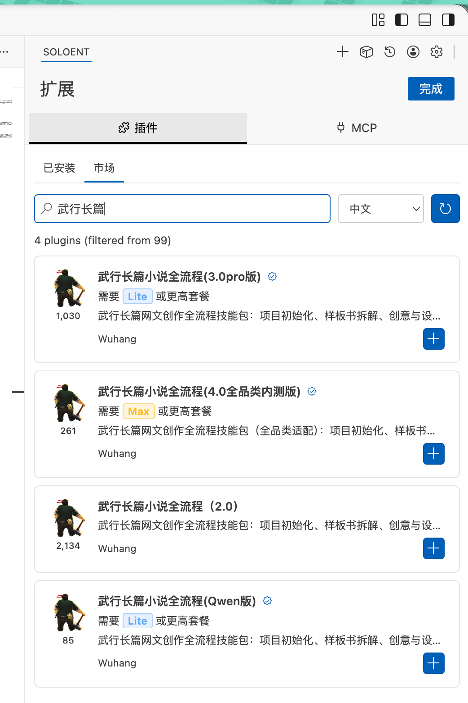

# Wuhang · Web Novel Writing Skill

[简体中文](README.md) · **English**

A long-form fiction workflow built from a web novelist's, editor's, and screenwriter's experience. Work with AI from an initial idea through worldbuilding, outlines, chapter drafts, and editorial review—or bring an existing manuscript and pick up where you left off.

[Video walkthrough (Chinese)](https://www.bilibili.com/video/BV1cz8i67ELD/) · [Download the v0.2.0 preview](https://github.com/AIGCwuhang/wuhang-novel-skill/releases/tag/v0.2.0)

## What it helps you do

- **Find your story's direction:** discuss genre boundaries, audience, core appeal, and prose style.
- **Develop the story and its outlines:** build characters, the world, and relationships; move from a book outline to volume and chapter outlines.
- **Draft and review one chapter at a time:** work from the outline and check motivation, continuity, pacing, and prose.
- **Continue an existing project:** organize your material and keep track of character states, foreshadowing, and next steps across sessions.

You make the creative decisions and review the results. Use only the stage you need. The workflow pauses after each chapter so you can decide what happens next.

## Get started

Choose the package for your tool:

| Tool | Download | Setup |
| --- | --- | --- |
| Codex | [Skill ZIP](https://github.com/AIGCwuhang/wuhang-novel-skill/releases/download/v0.2.0/wuhang-novel-skill-v0.2.0.zip) | Unzip the complete `wuhang-novel` folder into your novel project's `.agents/skills/` directory. [Detailed guide (Chinese)](docs/install-codex.md) |
| WorkBuddy | [WorkBuddy ZIP](https://github.com/AIGCwuhang/wuhang-novel-skill/releases/download/v0.2.0/wuhang-novel-workbuddy-v0.2.0.zip) | Import through the local skill upload option. This package is an import candidate pending client testing. [Guide (Chinese)](docs/install-workbuddy.md) |
| Editors that support VSIX | [VSIX](https://github.com/AIGCwuhang/wuhang-novel-skill/releases/download/v0.2.0/wuhang-novel-skill-0.2.0.vsix) | Install the VSIX, open your novel folder, then run `武行: 初始化长篇小说流程 Kit` from the command palette. [Guide (Chinese)](docs/install-vscode.md) |

After installation, create or open a folder for your novel and tell the AI:

> Use the wuhang-novel skill to initialize a project in this folder. I want to start from scratch. First, help me discuss the genre boundaries, core premise, and my expectations.

If you already have material, say what you want to organize and where you want to resume. You can also ask for a single task, such as reviewing a volume outline or developing the first three chapter outlines from existing story notes.

The core workflow does not require a separate API key. The optional batch-summary tool uses your own API configuration and incurs charges from your chosen provider. The skill instructions and default project templates are primarily in Chinese; specify your preferred writing language when starting a project.

The walkthrough may show an earlier version, but the overall workflow is similar. Follow the current setup instructions for installation and file paths. For help, see the [FAQ (Chinese)](docs/faq.md) or [open an issue](https://github.com/AIGCwuhang/wuhang-novel-skill/issues).

## Used by over 3,000 authors

Author-reported usage includes earlier SoloEnt versions. The screenshot below shows the plugin marketplace, not download figures for this GitHub release.

## About the author

Former Bronze-ranked Dragonlands player and former editor at Qidian (China Literature). Now a committed Vibe Writing advocate, an almost-invisible content creator, and a self-styled fiction-writing coach. Author, screenwriter, and AI content strategist.

---

Current version: 0.2.0 preview. See [LICENSE](LICENSE) for the current licensing status.
