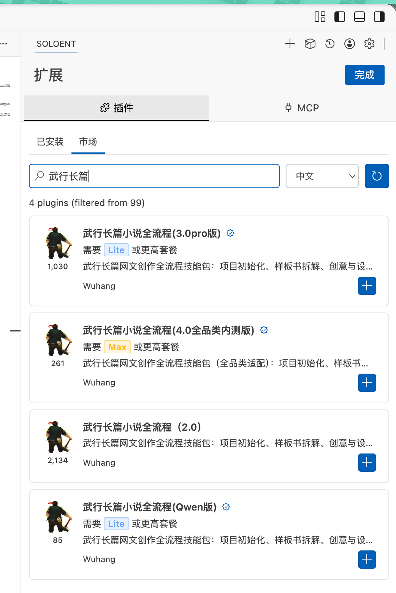

# 武行·网文创作 Skill

**简体中文** · [English](README.en.md)

把网文作者、编辑与编剧的创作经验，整理成一套可以与 AI 共同推进的长篇创作流程。从一个脑洞开始，到设定、大纲、逐章写作与审稿，也能带着已有稿件接着写。

[视频使用说明](https://www.bilibili.com/video/BV1cz8i67ELD/) · [下载 v0.2.0 预览版](https://github.com/AIGCwuhang/wuhang-novel-skill/releases/tag/v0.2.0)

## 可以帮你做什么

- **确定新书方向**：讨论题材边界、目标读者、核心看点和文风。
- **完善设定与大纲**：梳理人物、世界与关系，把故事细化为总纲、卷纲和章纲。
- **逐章创作与审稿**：依据章纲写作，检查人物动机、剧情接续、节奏与文字。
- **接入旧稿、管理连载**：整理已有素材，记录角色状态、伏笔和下一步，让新会话接得上。

你决定方向、审阅与取舍。流程支持只做当前环节；每章完成后暂停，等你决定是否继续。

## 开始使用

选择适合你的安装方式：

| 使用工具 | 下载 | 安装说明 |
| --- | --- | --- |
| Codex | [Skill ZIP](https://github.com/AIGCwuhang/wuhang-novel-skill/releases/download/v0.2.0/wuhang-novel-skill-v0.2.0.zip) | [查看说明](docs/install-codex.md) |
| WorkBuddy | [WorkBuddy ZIP](https://github.com/AIGCwuhang/wuhang-novel-skill/releases/download/v0.2.0/wuhang-novel-workbuddy-v0.2.0.zip) | [查看说明](docs/install-workbuddy.md) |
| 支持 VSIX 的编辑器 | [VSIX](https://github.com/AIGCwuhang/wuhang-novel-skill/releases/download/v0.2.0/wuhang-novel-skill-0.2.0.vsix) | [查看说明](docs/install-vscode.md) |

安装后，新建或打开本书的文件夹，告诉 AI：

> 使用武行小说创作技能，在当前文件夹初始化项目。我想从零开始，请先和我讨论题材边界、核心梗与预期。

已有稿件时，直接说明要整理哪些材料、从哪个环节继续。也可以只说“帮我审这份卷纲”或“根据现有设定细化前三章章纲”。

基础创作流程无需另外配置 API Key；可选的批量梗概功能需要你自己的 API 配置，费用由所选服务商收取。

视频版本可能与当前版本不同，但大致流程一致；安装方式和文件路径以当前说明为准。WorkBuddy 包目前为待客户端实测的导入候选包，具体状态见[安装说明](docs/install-workbuddy.md)。遇到使用问题可查看[常见问题](docs/faq.md)或[提交反馈](https://github.com/AIGCwuhang/wuhang-novel-skill/issues)。

## 超三千作者实际使用过

据作者介绍，使用情况包含 SoloEnt 历史版本；下图为插件市场页面截图，不代表本 GitHub 版本的下载量。

## 关于作者

前巨龙之巢青铜选手，前阅文起点编辑，现vibe writing 坚定支持者，现不知名非著名透明自媒体博主，现网文创作教学嘴炮能手，作者，编剧，AI 内容策划师

---

当前版本：0.2.0 预览版。许可范围见 [LICENSE](LICENSE)。
